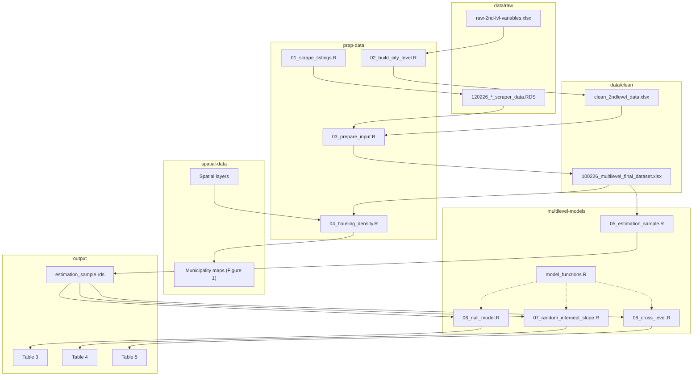

# str-density-colombia
This repository contains the replication data and R code for a multilevel analysis of short-term rental (STR) density and long-term rents in 18 Colombian cities in 2025. Using dwelling-level and city-level characteristics, the study draws on 6.803 web-scraped rental listings nested within 18 cities to examine the association between STR activity and long-term rental prices.

The repository is organized as follows. Each box is a folder, and the arrows show how the scripts turn the raw data into the results of the paper.

